# HCS architecture

Non-normative overview of how the HCS documents fit together. When this page and
a document in `spec/` disagree, the document wins. Requirement ids (`HCS-NNNN-RNNN`)
point to the rule each diagram summarizes.

## 1. Roles

HCS has three roles. A **distribution** publishes what hosts should run. A
**host** decides what it accepts and runs it. An **engine** (an agent runtime
such as a coding agent CLI or an agent server) is started by the host and only
sees what the host projects into it.

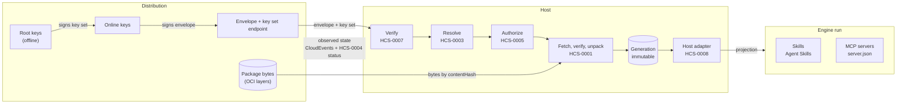

The lifecycle (HCS-0004) runs through every host step, and the typed errors
(HCS-0006) are what each step reports when it fails.

## 2. Document map

Arrows read "requires". HCS-0000 (conventions) is required by everything and is
left out of the arrows.

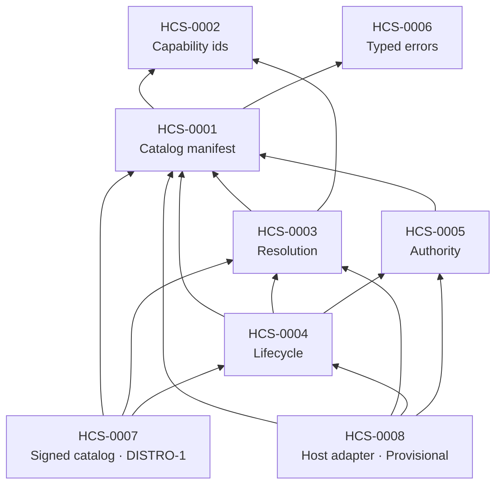

| Layer | Documents | Question it answers |
| --- | --- | --- |
| Data | HCS-0001, HCS-0002, HCS-0006 | What a catalog, a capability id and an error look like |
| Decision | HCS-0003, HCS-0005 | Which entries can run, in which order, with which permissions |
| Execution | HCS-0004, HCS-0008 | How entries move between states and reach an engine |
| Distribution | HCS-0007 | Who published the catalog, whether it is current and for this host |

The profiles group requirements: **CORE-0** (documents, resolution, typed errors)
and **DISTRO-1** (HCS-0007, on top of CORE-0, with the `all-or-nothing` policy).

## 3. From envelope to confirmed generation

One update, end to end. Each step stops at its first failure and reports an
HCS-0006 error; the previously confirmed generation keeps running throughout.

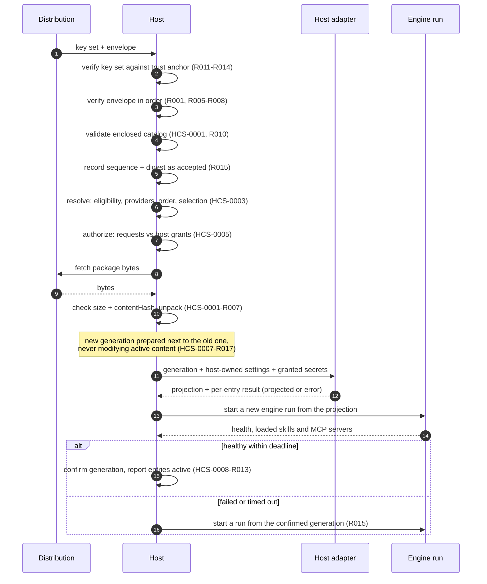

## 4. Envelope verification (HCS-0007 section 5.2)

The order is part of the contract: a host reports only the first failing check
(R009), so two hosts give the same error for the same envelope.

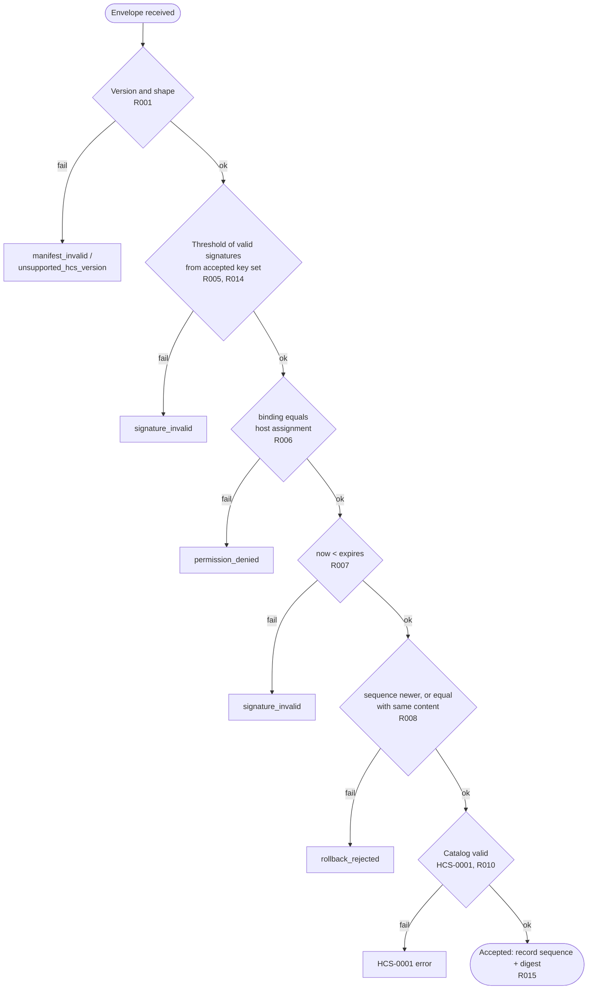

Trust anchor and assignment are host inputs received at enrollment; how a host
is enrolled is outside HCS today (issue #26).

## 5. Resolution (HCS-0003)

Resolution runs before any package code. It is a pure function of the catalog
and a description of the host, which is what makes it testable by data-only
conformance cases.

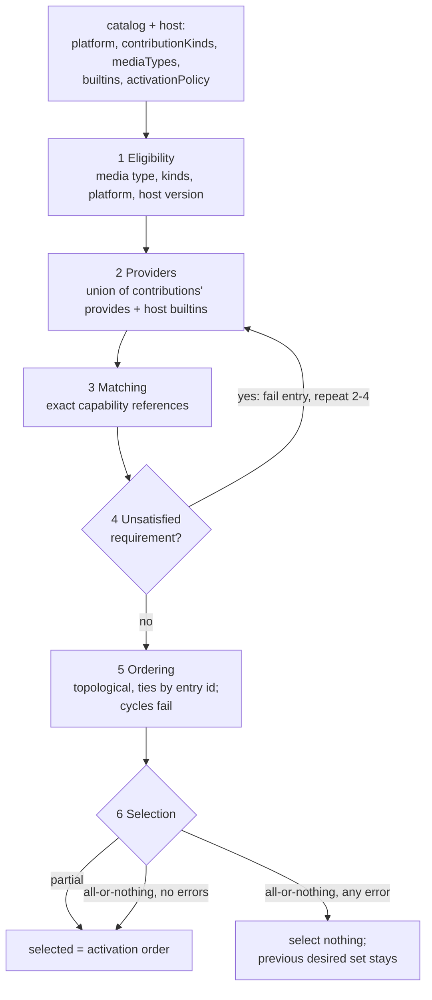

Output: `activationOrder`, `errors` (each with `entry` and, where relevant,
`capability`) and `selected`.

## 6. Entry lifecycle (HCS-0004)

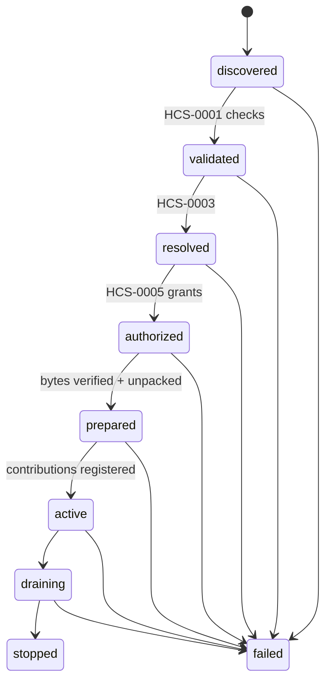

No package code runs before `active`. Moving from one desired set to the next is
one step: the new set is prepared separately and switched to atomically
(HCS-0004-R003, HCS-0007-R017).

## 7. Generations and projection (HCS-0008)

A **generation** is the prepared, unpacked content of the selected entries,
identified by an id and never modified. An engine run sees exactly one
generation, whole (R001, R002). The `active` pointer only chooses the generation
of the *next* run.

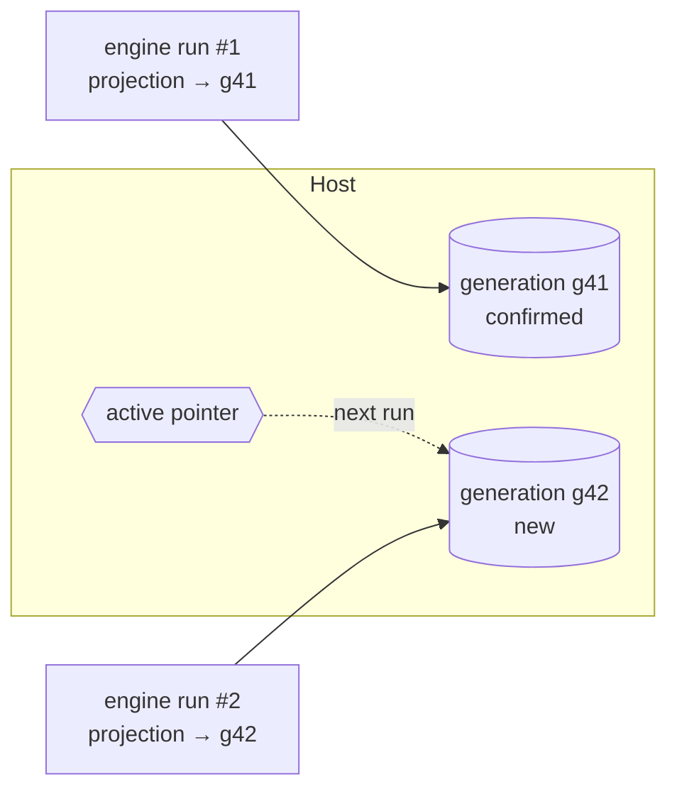

For each contribution of each entry, the adapter either projects it or reports
an error; nothing is dropped silently (R003).

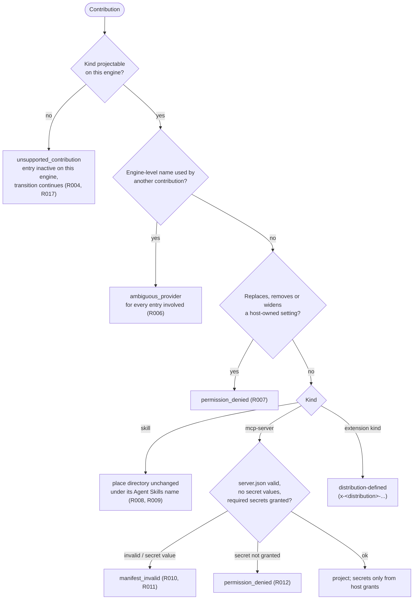

A contribution with the same name as a **host-provided default** (for example a
bundled skill) replaces it; that is not a collision. A contribution may
**narrow** a host-owned setting, never widen it.

## 8. Confirm after health (HCS-0008 section 7)

Boot counting with one try: a new generation is unconfirmed until the running
engine proves it, a failed generation is not retried, and there is exactly one
rollback.

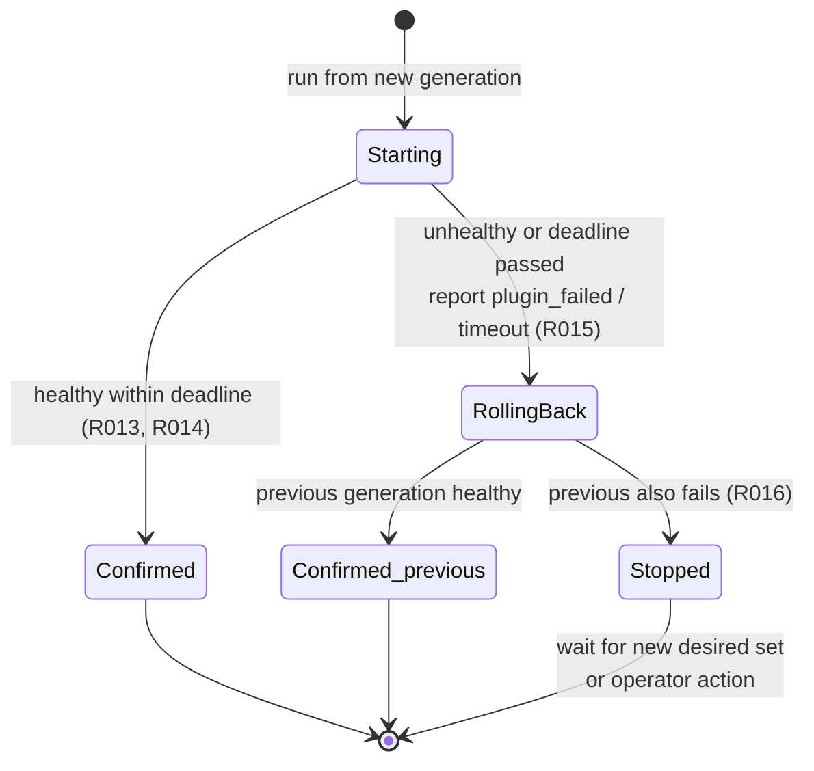

When the engine reports what it loaded, a projected skill or MCP server missing
from that report fails the check (R014).

## 9. Authority (HCS-0005)

Packages request; the host grants. A request is never a grant, and the decision
is made by the host at the moment of the operation.

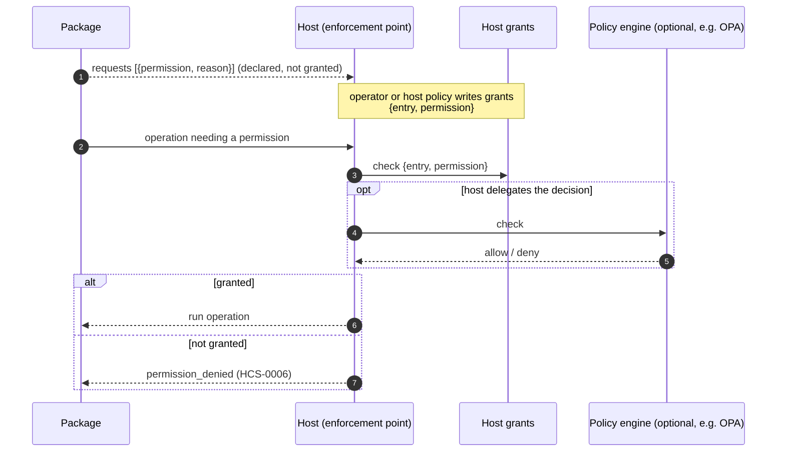

HCS defines the shapes and enforcement rules only; the permission vocabulary,
policy language and trust tiers belong to the distribution (OQ-0005-1).

## 10. Errors on the wire (HCS-0006)

One error object, a closed set of codes, carried inside the transport's own
error shape. Consumers branch on `code`, never on `message`.

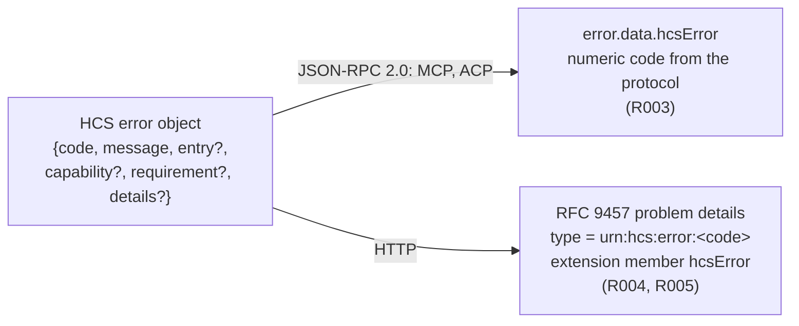

## 11. How the repository is built

Prose is normative, schemas define shapes, and every MUST has a case that
satisfies it and one that violates it (HCS-0000-R001).

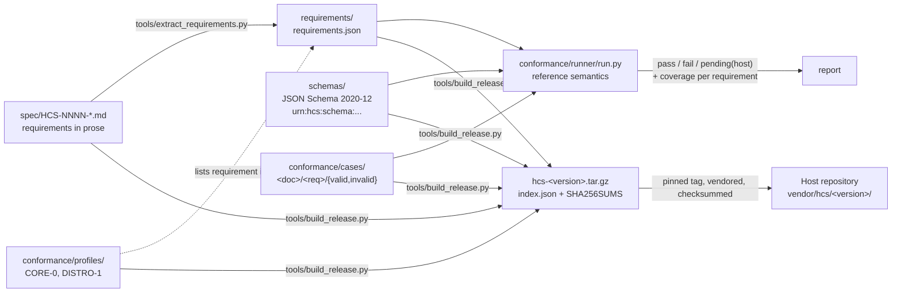

The reference runner executes the `document`, `integrity`, `resolution`,
`authority`, `distribution` and `projection` levels. `host` cases describe a
scenario that needs a running host and are reported `pending` until a
system-under-test interface exists (issue #20). See the README, "How to pin
HCS", for the consumer side.

## 12. What HCS reuses instead of defining

| Need | Standard | Where in HCS |
| --- | --- | --- |
| Requirement keywords | BCP 14 (RFC 2119, RFC 8174) | HCS-0000 |
| Document shapes | JSON Schema 2020-12 | `schemas/` |
| Package format, platforms, digests | OCI image spec (layers, platform object) | HCS-0001 |
| Distribution security properties | TUF (sequence, expiry, thresholds, key rotation) | HCS-0007 |
| Canonical form and signing envelope | RFC 8785 JCS, DSSE, Ed25519 | HCS-0007 |
| Provenance | SLSA Provenance v1 in in-toto | HCS-0007-R020 |
| Skills | Agent Skills | HCS-0001, HCS-0008 |
| MCP server descriptor | MCP Registry `server.json` | HCS-0008 |
| Instructions | AGENTS.md | HCS-0008 (extension kinds) |
| Tool calls, client/agent | MCP, ACP over JSON-RPC 2.0 | HCS-0006 |
| HTTP errors | RFC 9457 problem details | HCS-0006 |
| Observed state | CloudEvents 1.0.2 | HCS-0007-R021 |
| Health states | Kubernetes conditions, gRPC health, UAPI boot counting | HCS-0008 |
| Policy decisions | OPA (optional) | HCS-0005 |

Pinned notes on each standard live in `docs/standards/`; the reasons behind
each choice live in `docs/adr/`.
