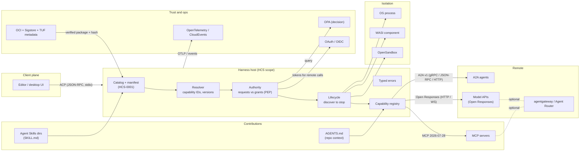

# Composition map: how the standards fit around a harness host

**Status:** research note, not normative. Access date: 2026-11-06.
**Labels:** [F] verified fact with source; [I] inference; [U] not verified. Facts are sourced in [standards-catalog.md](standards-catalog.md) and [sources.md](sources.md); this file mostly reasons over them, so most claims here are [I].

## 1. Planes and who talks to whom

A harness host sits in the middle. Each external standard owns one plane; HCS owns only what the host does with plugins.

Wire protocols on the edges: ACP is JSON-RPC 2.0 [F] (catalog: ACP), typically with the agent as a stdio subprocess [U]; MCP 2026-07-28 is stateless JSON-RPC with `server/discover` [F]; A2A v1 offers JSON-RPC, gRPC and HTTP+JSON bindings [F] (pre-verified); Open Responses is HTTP plus a WebSocket transport since 2026-04-24 [F].

## 2. Overlaps and conflicts

| Pair | Where they overlap | Resolution for HCS |
| --- | --- | --- |
| **ACP vs A2A** | Both carry agent tasks/messages | ACP is client ↔ agent (editor drives one agent over stdio); A2A is agent ↔ agent across services with Agent Cards. [F] A host speaks ACP upward and A2A outward; HCS needs neither in CORE-0. [I] |
| **MCP vs agentgateway / Agent Router** | Gateways proxy and authorize MCP traffic | MCP is the protocol; gateways are deployment components. [F] HCS treats a gateway as just another MCP endpoint; gateway policy does not replace host grants. [I] |
| **Agent Skills vs AGENTS.md** | Both inject instructions into model context | Skills are packaged, named, loadable on demand; AGENTS.md is ambient repo context with no schema. [F] HCS: skills are a contribution type in the manifest; AGENTS.md is read by the agent runtime, not installed. [I] |
| **Skills `allowed-tools` vs host grants** | Skill frontmatter lists pre-approved tools | `allowed-tools` is experimental and advisory. [F] Host grants win; a skill can request, never grant. [I] |
| **OPA decision vs host enforcement** | OPA returns allow/deny | OPA is a PDP; the host must enforce at dispatch time and on handle delivery. [F]/[I] HCS defines the request/decision shape and the enforcement points, not the policy language. [I] |
| **OCI + Sigstore vs TUF** | Integrity of distributed packages | OCI gives content addressing; Sigstore gives publisher identity and transparency. Neither prevents rollback, freeze or mix-and-match of metadata; TUF defines those protections. [I], consistent with the Notion page's own warning. HCS DISTRO-1 should require TUF-style properties (signed, versioned, expiring catalog metadata), with OCI as optional transport. [I] |
| **MCP tasks extension vs HCS lifecycle** | Long-running work | MCP tasks (now an extension) are per-call jobs on a server. [F] HCS lifecycle is per-plugin (install, activate, drain). Different granularity; no conflict. [I] |
| **OpenSandbox vs WASI vs process** | Isolation | Three execution backends with different guarantees. [F]/[I] HCS defines an isolation profile with negative tests; backends claim it by passing them. [I] |
| **OTel GenAI vs HCS events** | Telemetry for agent/tool calls | GenAI semconv (Development) covers model/agent/MCP spans. [F] HCS defines lifecycle event names only and maps tool calls onto GenAI/MCP attributes at a pinned semconv commit. [I] |
| **Cordis / OpenClaw vs HCS** | Manifest, dependency injection, reversible registrations, capability registry | Both implement this internally in TypeScript. [F] HCS's only defensible difference is a language-neutral, schema-first contract plus conformance across hosts. If that is not needed, adopting one of them is cheaper (README rule 6). [I] |

## 3. Seams HCS must define (nothing else covers them)

Each seam lists what existing standards give and what is missing. All [I] unless marked.

1. **Catalog manifest (HCS-0001).** Missing everywhere: no standard describes "this harness distribution wants these packages at these versions with these hashes". Closest: OCI index (transport, not desired state), TUF targets metadata (hashes and lengths, no contributions), OpenClaw `openclaw.plugin.json` (product-specific). [F] for the three references.
2. **Capability IDs.** MCP tool names are server-local strings; A2A has skills in Agent Cards; Agent Skills have `name`. None defines a stable, versioned, implementation-independent capability ID. HCS needs `namespace.name` plus contract version, separate from the implementing package (Notion: "capability name ≠ implementing plugin").
3. **Resolution.** requires/provides, provider selection, version ranges with defined semantics, cycle detection, deterministic errors. Cordis does injection by service key at runtime [F]; nothing does it declaratively before execution.
4. **Lifecycle.** State machine (discovered → validated → resolved → authorized → prepared → active → draining → stopped/failed), atomic activation, rollback of partial effects. Cordis "reversible effects" [F] is the closest precedent.
5. **Authority / grants.** Plugin requests vs host grants per subject/project/session/operation, deny by default, re-check at dispatch. OAuth scopes, OPA and Skills `allowed-tools` each touch a slice; none defines the plugin-to-host grant contract.
6. **Typed errors.** A small closed code set (`missing_dependency`, `version_incompatible`, `permission_denied`, `timeout`, `plugin_failed`, `unsupported_capability`) with a mapping to JSON-RPC errors (MCP/ACP) and to RFC 9457 for HTTP.
7. **Conformance profiles.** Requirement IDs, fixtures, runner and report format (see [how-standards-are-built.md](how-standards-are-built.md#4-recommended-template-for-the-hcs-repo)).

What HCS must **only adapt**: MCP (tools), ACP (client), A2A (remote agents), Open Responses (models), Agent Skills (procedure packages), OTel/CloudEvents (telemetry and events), OPA (optional PDP), OCI/Sigstore/TUF (distribution), WASI/OpenSandbox (isolation backends).

## 4. Minimal composition for HCS 0.1

Scope per README: `HCS-0001` catalog manifest for a desired-state distribution; first consumer HagaHarness desktop.

**In 0.1**

- `HCS-0000` conventions: BCP 14, requirement IDs, stability markers, versioning. [I]
- `HCS-0001` catalog manifest: `hcsVersion`, catalog `id`, entries with package `id`, `version`, `contributions` (typed list: `skill`, `mcp-server`, ... as opaque kinds), `contentHash` (algorithm-prefixed digest), `size`, `compatibility`; `x-<distribution>` extension namespace. These are the README's fields. [F] (README)
- JSON Schema 2020-12 for it, valid/invalid fixtures, a document-level conformance runner. [I]
- External standards actually referenced normatively in 0.1: **JSON Schema 2020-12** and **BCP 14** only. Agent Skills and MCP appear as contribution kinds by name, without HCS restating their formats. [I]

**Not in 0.1:** resolution semantics beyond "exact version", grants, lifecycle, ACP/MCP adapters, signing. A desired-state distribution can verify `contentHash` and `size` without any of them. [I]

Why hash and size first [I]: they give TUF's integrity property for targets (hash plus length) without TUF's role and expiry machinery; a later DISTRO-1 can wrap the same catalog in signed, versioned, expiring metadata.

## 5. Later profiles

| Profile | Adds | External standards it binds | Exit test |
| --- | --- | --- | --- |
| **CORE-0** | manifest + capability IDs + resolution + lifecycle + typed errors + document conformance | JSON Schema, BCP 14 | two hosts load the same catalog, reject the same invalid fixtures with the same error codes |
| **TOOLS-1** | MCP tool adapter, per-call grant check, cancellation | MCP (pinned revision, 2026-07-28 or explicitly 2025-11-25) | same MCP-backed plugin passes on two hosts |
| **AGENT-1** | ACP surface for clients, optional A2A remote delegation | ACP wire v1, A2A v1 | an ACP client drives two hosts identically |
| **ISOLATION-1** | declared isolation level with negative tests (no fs, no net, resource limits) | OS process, WASI 0.3, OpenSandbox as backends | denied operations fail on every claimed backend |
| **DISTRO-1** | signed catalog metadata, rollback/freeze protection, staging and rollback of activation | TUF properties; OCI + Sigstore optional transport/signing; SPDX/SLSA optional attestations | rollback and freeze attacks rejected; failed update restores previous set |

All rows [I].

## 6. Risks

- **Duplication of Cordis/OpenClaw** (README rule 6): if a second consumer (RE;write) never appears, HCS is a private format and should stay one. [I]
- **MCP churn:** the 2026-07-28 revision broke the session model a year after 2025-11-25; TOOLS-1 must pin and test a revision. [F] for the change, [I] for the recommendation.
- **Immature dependencies:** OTel GenAI (Development), ACP v2 (alpha), WASI (preview), OpenSandbox (AAIF Sandbox stage). Bind none of them normatively in CORE-0. [F] for statuses, [I] for the recommendation.
